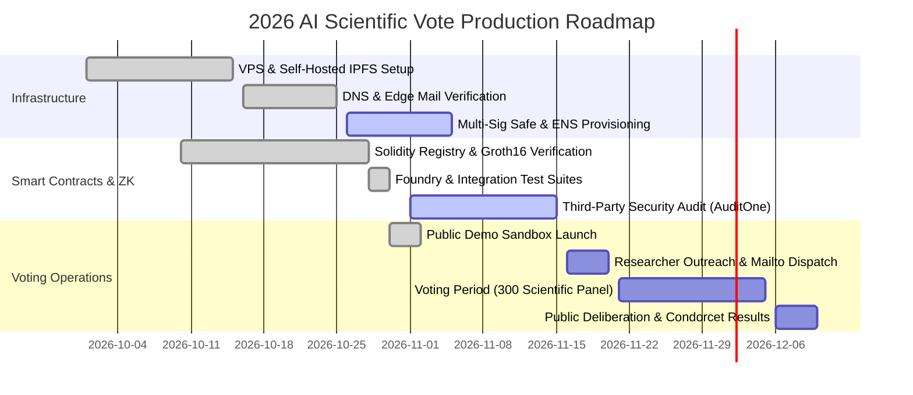

# Executive System Overview: 2026 AI Scientific Vote
## Decentralized, Sybil-Resistant Deliberation on Frontier AI Safety & Capabilities

**Classification:** Executive Briefing & Architecture Overview  
**Target Audience:** C-Level Executives, Board Members, Project Directors, Governance Committees  
**System Architecture:** Non-Custodial Zero-Knowledge Deliberation & Sovereign Ballot Box  
**Reference Frontend:** [Scientific_Vote_App_v5.html](file:///d:/workspace/dapp/zk-circuit/Scientific_Vote_App_v5.html)

---

## 1. Executive Summary & Problem Statement

Modern artificial intelligence policy and frontier safety governance face a fundamental institutional challenge: **public discourse is noisy, polarized, and heavily distorted by commercial marketing budgets, while scientific consensus remains difficult to measure objectively.**

Traditional opinion polls and corporate surveys suffer from three critical flaws:
1. **Lack of Authenticity & Sybil Attacks:** Anonymous surveys can be flooded by botnets, sybil accounts, or coordinated PR campaigns.
2. **Loss of Privacy for Top Researchers:** High-profile scientists are often reluctant to speak candidly about frontier existential risks, lab capabilities, or commercial safety practices due to corporate advisory ties, university funding dependencies, or career repercussions.
3. **Custodial Manipulation:** Centralized survey platforms (Google Forms, Qualtrics, Typeform) hold the raw data, allowing administrators to manipulate tallying, cherry-pick respondents, or leak confidential participant records.

The **2026 AI Scientific Vote** provides a mathematically verifiable alternative: a **zero-custody, decentralized deliberation platform** that gathers rigorous positions and qualitative rationales from the world's leading AI researchers, industry practitioners, and the general public.

Every vote is sealed on the voter's local device, proven using **zero-knowledge cryptography (Groth16)**, verified against **cryptographic institutional email signatures (DKIM)**, and permanently auditable on the blockchain—**without any server ever learning the voter's identity, email address, or private key.**

```
+----------------------------------------------------------------------------------------------------+
|                                      THE 2026 SCIENTIFIC VOTE FLOW                                 |
+----------------------------------------------------------------------------------------------------+
|                                                                                                    |
|  [ 1. Genesis & Auth ]      [ 2. Deliberation ]      [ 3. Zero-Secret Proof ]   [ 4. Public Receipt ] |
|  - In-Browser WebCrypto     - 5 Statements           - Zero-Knowledge Groth16   - Sealed .ebundle.json
|  - Secure Enclave Keypair   - Position (1-10)        - DKIM RSA-2048 Mail Proof - On-Chain Nullifier |
|  - TouchID / ORCID / SSO    - Weight & Rationale     - Zero Secret Exposed      - 100% Offline Audit  |
|            |                         |                          |                         |        |
|            v                         v                          v                         v        |
|  (Local Browser RAM)    (Deterministic Payload)    (WebAssembly Prover)       (IPFS & Ethereum)    |
|                                                                                                    |
+----------------------------------------------------------------------------------------------------+
```

---

## 2. The Three-Lane Deliberation Model

To ensure fair representation while maintaining clear domain separation, the platform segments voters into three transparent, cryptographically distinguished lanes:

| Cohort Lane | Eligibility Manifest & Ingestion | Identity & Privacy Model | Deliberation Weight & Purpose |
|:---|:---|:---|:---|
| **1. Scientific Panel** *(Primary)* | **Top 300 AI Researchers** algorithmic citation index from **OpenAlex** (Manifest `9f3c4b…e011`). Zero commercial equity allowed. | **Zero-Knowledge Anonymity.** Institutional DKIM proof binds voter to verified seat while zero-knowledge circuit shields their specific identity. | **Highest Academic Weight.** Establishes the peer-reviewed scientific baseline on AGI timelines and existential risk. |
| **2. Industry Stakeholders** | Verified researchers, founders, and engineers at commercial AI labs (OpenAI, Anthropic, Google DeepMind, Meta, etc.). | **Full Financial Transparency.** Verified via corporate email DKIM, with company name, equity stake, and advisory board disclosures published alongside vote. | **Industry Perspective.** Quantifies perspectives from engineers with direct access to frontier model training runs while exposing conflicts of interest. |
| **3. General Public** | Global citizens and public community members. | **Sybil-Resistant Personhood.** Verified via decentralized identity (Passkey, WorldID, or WebAuthn) ensuring exactly one vote per human. | **Public Consensus.** Assesses societal alignment, trust in regulatory safeguards, and technological optimism across global civil society. |

---

## 3. The 4-Stage Voter Journey

The application is engineered to provide an effortless, high-trust experience that requires **less than 4 minutes** for a researcher to complete:

### Stage 1: Identity Genesis & Keypair Generation
* **What happens:** The voter visits the decentralized web application (hosted via ENS at `rationalprocess.eth` or IPFS).
* **The Technology:** In the voter's browser, the W3C WebCrypto API generates an ephemeral **ECDSA P-256 keypair** isolated in browser memory or the device's hardware Secure Enclave (Apple TouchID / FaceID / Windows Hello).
* **Executive Takeaway:** No passwords, no seed phrases, no wallet installations (MetaMask not required). The user authenticates using standard academic credentials (ORCID, institutional eduGAIN SSO, or Google Workspace).

### Stage 2: Answering the 5 Delphi Statements
* **What happens:** The voter responds to 5 consensus statements concerning frontier AI capabilities, existential safety, open weights, compute governance, and institutional liability.
* **Granular Input:** For each statement, the voter selects:
  1. **Position Scale (1 to 10):** From strong disagreement (1) to absolute agreement (10).
  2. **Opinion Weight (1 to 5):** Voter confidence and domain expertise on that specific topic.
  3. **Qualitative Rationale:** Text justification explaining the mechanistic reasoning behind their score.
* **Executive Takeaway:** Captures both quantitative distributions and qualitative nuance, enabling Condorcet-consistent consensus analysis rather than binary yes/no polls.

### Stage 3: Zero-Secret Eligibility Proof
* **What happens:** The voter proves they belong to the selected seat or organization without revealing their inbox or private key.
* **The Technology:**
  1. The browser generates a short cryptographic challenge binding the voter's ephemeral public key:
     `SV-AI-2026-CLAIM:seat=0:lane=sci:anon=0:coi=0:pk=0x040b9730...`
  2. The voter sends a blank email from their institutional address (`@umontreal.ca`, `@berkeley.edu`, `@stanford.edu`) to the system verifier address (`verify@rationalprocess.eth`).
  3. Alternatively, mobile voters simply scan the **dynamic on-screen QR code**, which deep-links directly into their mobile email client (Gmail, Apple Mail, Outlook Web) with pre-filled headers.
  4. The university mail server signs the email headers using standard **RSA-2048 DKIM**.
  5. The client-side **WebAssembly Worker Prover** (`zk-prover.worker.js`) computes a **Groth16 zero-knowledge proof** in background memory (~3.2 seconds) with a liquid progress indicator, keeping the UI 100% responsive.
* **Executive Takeaway:** The user never provides access tokens or passwords to their email inbox. Institutional proof is derived entirely from public DNS cryptographic signatures (DKIM/DNSSEC).

### Stage 4: Ballot Sealing & Offline Public Verification
* **What happens:** The final ballot is sealed into an immutable, self-contained bundle (`.ebundle.json`), containing:
  - The voter's 213-byte domain-separated ECDSA signature.
  - The Groth16 zero-knowledge proof points ($A \in G_1, B \in G_2, C \in G_1$).
  - The deterministic nullifier commitment preventing double-voting.
* **Executive Takeaway:** Any third party, journalist, or auditor can drop the `.ebundle.json` into the built-in offline inspector to verify cryptographic validity 100% client-side without internet connectivity.

---

## 4. Zero-Custody & Trust Model Invariants

The platform adheres to four strict architectural invariants designed to eliminate institutional and legal liability:

```
+----------------------------------------------------------------------------------------------------+
|                                    FOUR PILLARS OF ZERO CUSTODY                                     |
+----------------------------------------------------------------------------------------------------+
|                                                                                                    |
|  1. ZERO INBOX ACCESS        2. ZERO PRIVATE KEY CUSTODY    3. COMPLETE ANONYMITY    4. TAMPER-PROOF |
|  Mail servers sign outgoing  Voter keys are created in-     Smart contracts verify   Election bundles
|  headers via DKIM. The app   memory and discarded after     nullifiers. It is        are pinned to IPFS
|  never reads, stores, or     voting. No centralized server  mathematically impos-    and verified on-
|  routes email bodies.        ever touches private keys.     sible to unmask votes.   chain via zk-SNARKs.
|                                                                                                    |
+----------------------------------------------------------------------------------------------------+
```

1. **Zero Inbox Access:** The verifier service only checks the cryptographic DKIM signature on the email headers. It never requests IMAP/OAuth permissions to access the researcher's inbox, sent items, or contacts.
2. **Zero Private Key Custody:** The voter's signing keys are created in ephemeral memory and discarded upon completion. No private key is ever transmitted over the network or stored in centralized databases.
3. **Cryptographic Anonymity (Unlinkable Nullifiers):** The smart contract tracks voter participation using Poseidon-hashed cryptographic nullifiers. Even the platform operators cannot trace which scientist cast which ballot.
4. **Sovereign Verifiability:** The entire deliberation record is published to IPFS and anchored on Ethereum smart contracts (`PanelRegistry.sol` and `Groth16Verifier.sol`), creating an immutable historical record immune to censorship.

---

## 5. Funding & Governance Model (Rethink Finance Vault)

In strict adherence to the project charter:
> *"You keep the asset. You contribute the yield. 1,000 ETH staked into the vault (~2.5% yield) -> ~25 ETH per year funding the work. No salaried staff, by design."*

* **Autonomous Staking Yield:** All infrastructure hosting, gas sponsorship for academic voters, and audit bounties are funded from the yield generated by the **Rethink Finance staking vault** (`soonami4good.rethink.finance`).
* **Multi-Signature Governance:** Disbursements and parameter updates are governed by a **3-of-5 Gnosis Safe multisig smart account**, ensuring no single administrator or entity can alter election rules or siphon treasury yield.
* **Zero Salaried Overhead:** By leveraging decentralized edge computing, self-hosted containerized relays, and zero-knowledge client provers, ongoing operations cost less than **$250/year in infrastructure fees**, preserving treasury capital indefinitely.

---

## 6. Executive Roadmap & Production Milestones



1. **Phase 1: Architecture & Prototyping (Completed):** Complete client-side zero-knowledge ballot box, WebAssembly worker prover, vector QR deep-linking, and Foundry cryptographic test matrix (50/50 tests passing).
2. **Phase 2: Infrastructure Provisioning & Multi-Sig (Current):** Setup of corporate edge workers, self-hosted Kubo IPFS daemon, Gnosis Safe multisig treasury, and ENS domain records (`rationalprocess.eth`).
3. **Phase 3: Formal Security Audit (Upcoming):** Hand-off of finalized contracts (`PanelRegistry.sol`, `Groth16Verifier.sol`) to **AuditOne** partners under milestone bounty.
4. **Phase 4: Global Election Execution:** Dispatching academic verification challenges to the 300 selected panel scientists, collecting signed deliberation ballots, and publishing decentralized consensus analytics.
